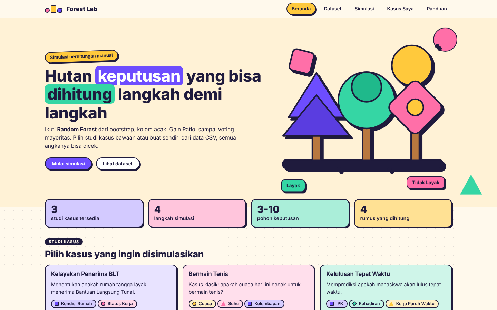
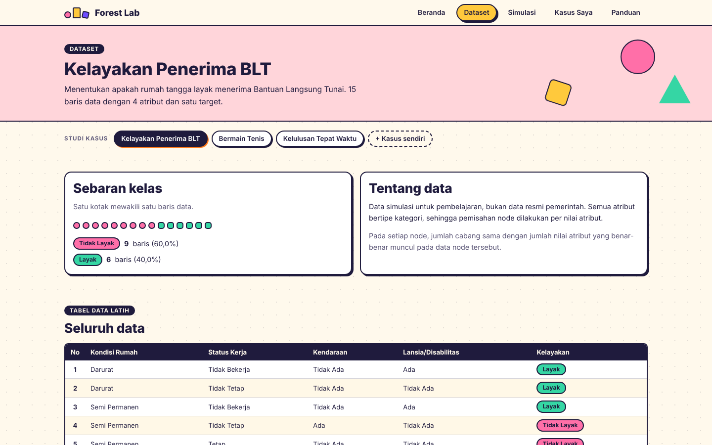
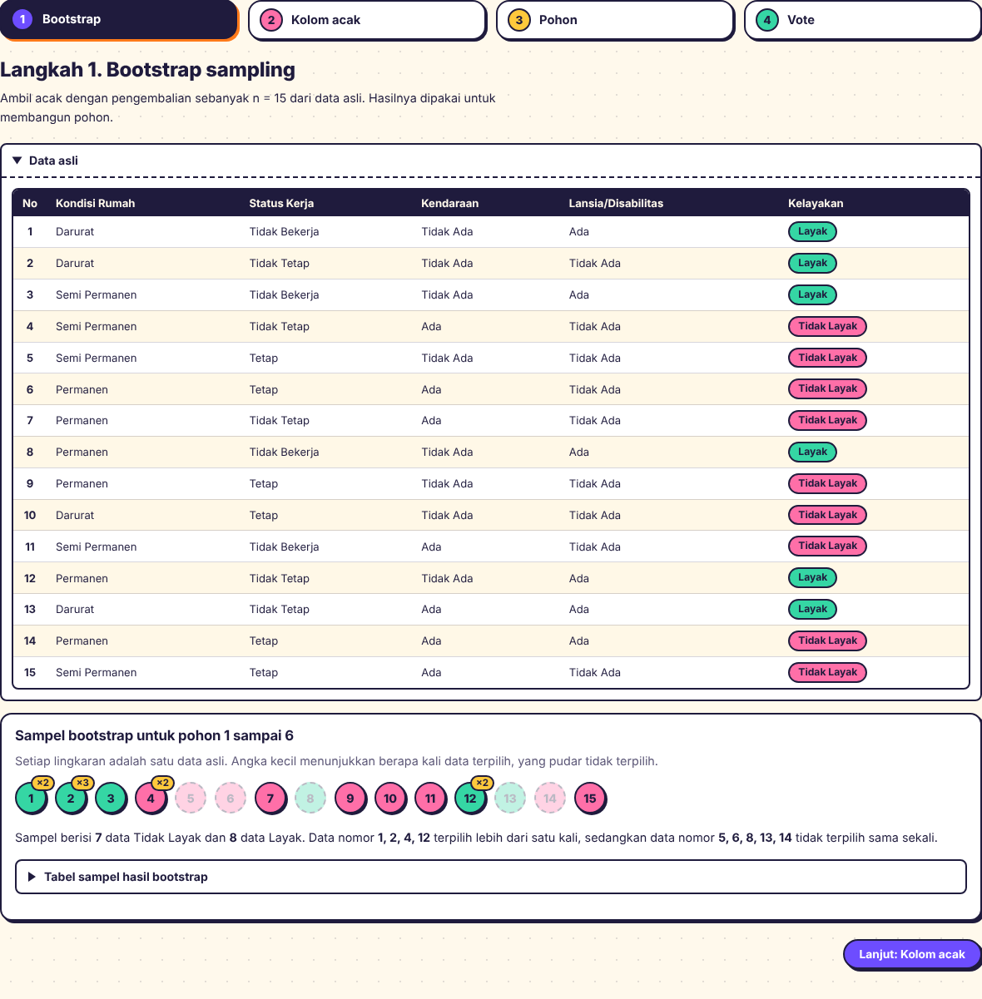
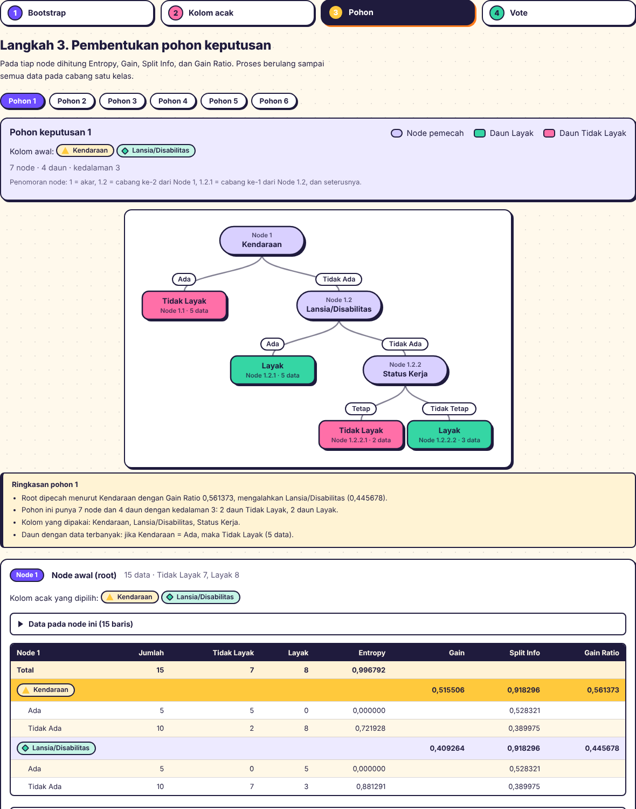
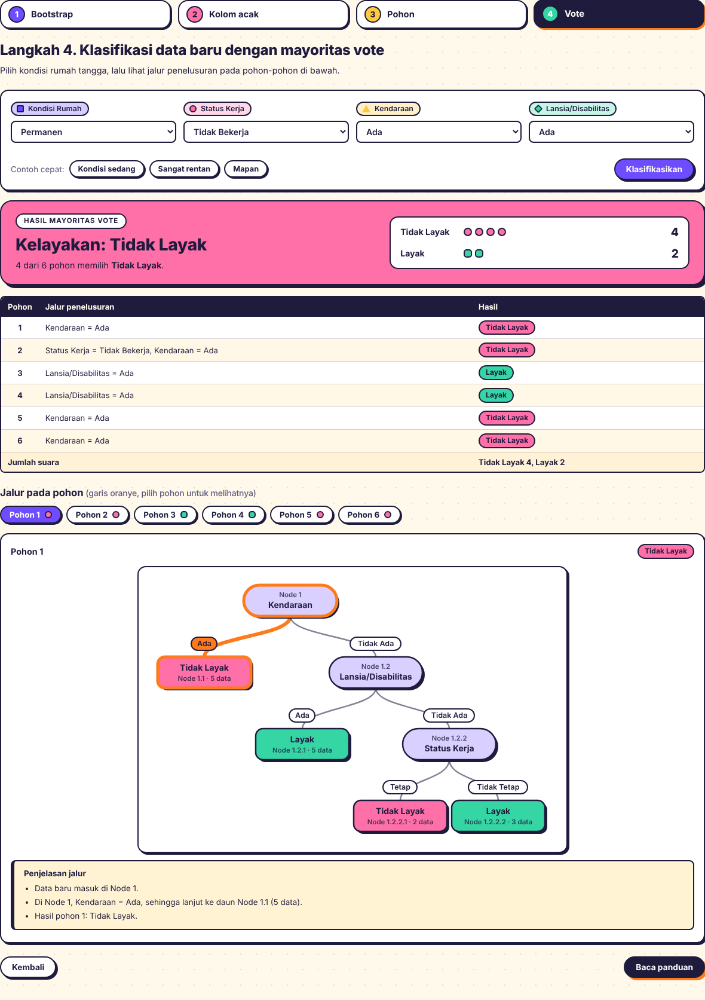
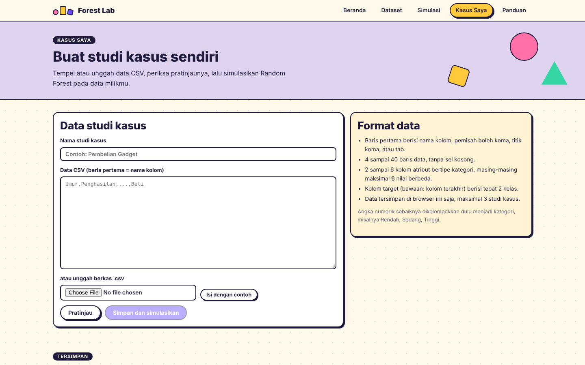
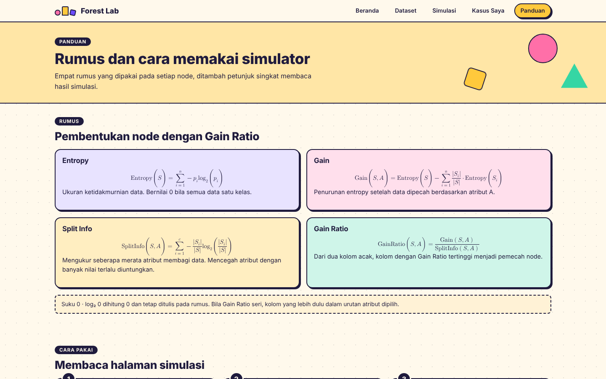

# Forest Lab - Simulasi Random Forest dengan Beberapa Studi Kasus


Aplikasi web Flask yang mensimulasikan **perhitungan manual Random Forest** langkah demi langkah pada tiga studi kasus: **Kelayakan Penerima BLT**, **Bermain Tenis**, dan **Kelulusan Tepat Waktu**. Setiap node menampilkan penjelasan otomatis yang berubah mengikuti hasil simulasi, tabel Entropy, Gain, Split Info, dan Gain Ratio, gambar pohon keputusan, serta hasil mayoritas vote dengan jalur penelusuran berwarna. Tampilan memakai gaya **Playful Geometric**.

---

## Halaman Aplikasi

| Halaman | Isi |
|---|---|
| **Beranda** | Pengenalan konsep, alur empat langkah, dan studi kasus |
| **Dataset** | Tabel 1 (15 baris), sebaran kelas, arti dan sebaran tiap atribut |
| **Kasus Saya** | Tambah studi kasus sendiri dari data CSV (tempel atau unggah), pratinjau, simpan, dan hapus |
| **Simulasi** | Bootstrap, kombinasi kolom acak, pembentukan enam pohon, dan klasifikasi data baru dengan vote |
| **Panduan** | Rumus Entropy, Gain, Split Info, Gain Ratio, dan cara membaca simulasi |


---

## Tampilan Aplikasi

| Beranda | Dataset |
|---|---|
|  |  |

| Simulasi: Bootstrap | Simulasi: Pohon Keputusan |
|---|---|
|  |  |

| Simulasi: Vote | Kasus Saya |
|---|---|
|  |  |

| Panduan |
|---|
|  |

---

## Teknologi

| Komponen | Teknologi |
|---|---|
| Backend | Flask 3, Gunicorn |
| Algoritma | Python murni (tanpa scikit-learn) agar tiap langkah bisa ditampilkan |
| Pohon keputusan | Tata letak dihitung di Python, digambar sebagai SVG oleh Jinja2 |
| Frontend | HTML (Jinja2), CSS, JavaScript |

---

## Studi Kasus dan Dataset

Studi kasus dipilih lewat tombol di halaman Dataset dan Simulasi (`?kasus=blt|tenis|lulus`). Studi kasus sendiri dibuat di halaman **Kasus Saya**: tempel atau unggah CSV (baris pertama nama kolom, 4 sampai 40 baris, 2 sampai 6 atribut, kolom target dengan tepat 2 kelas). Data tersimpan di cookie session browser (maksimal 3 kasus), jadi set `SECRET_KEY` di server produksi. Kasus bawaan juga bisa ditambah lewat satu objek `Case` di `cases.py`.

Contoh utama (BLT):

- **Target:** Kelayakan (Layak atau Tidak Layak)
- **Atribut (4):** Kondisi Rumah, Status Kerja, Kendaraan, Lansia/Disabilitas
- **Data latih:** 15 baris simulasi (9 Tidak Layak, 6 Layak), bukan data resmi pemerintah
- **Pembentukan node:** Gain Ratio, dengan m = 2 kolom acak per node

---

## Instalasi Lokal

```bash
git clone https://github.com/Alnazh/tugas1-ml-random-forest-blt.git
cd tugas1-ml-random-forest-blt

python -m venv venv
# Windows: venv\Scripts\activate
source venv/bin/activate

pip install -r requirements.txt
python app.py
```

Buka `http://127.0.0.1:5000`.

## Menjalankan Uji

```bash
python -m unittest tests.test_forest
```

Uji memastikan algoritme menghasilkan angka yang sama dengan perhitungan manual BLT (sampel perhitungan manual dimasukkan langsung di tes) (Gain Ratio root, pemecah tiap node, dan vote 4 Tidak Layak : 2 Layak), memastikan label cabang pohon tidak saling menimpa, dan memvalidasi data studi kasus buatan sendiri.


## Struktur Project

```
tugas1-ml-random-forest-blt/
├── app.py            # Rute Flask dan pembacaan input
├── cases.py          # Data dan teks studi kasus bawaan
├── custom_case.py    # Validasi CSV dan pembuatan studi kasus sendiri
├── config.py         # Pengaturan aplikasi
├── forest.py         # Bootstrap, Gain Ratio, pembentukan pohon, prediksi, vote
├── formulas.py       # Teks rumus dan penjelasan otomatis
├── tree_view.py      # Tata letak pohon untuk SVG
├── tests/test_forest.py
├── templates/        # base, macros, index, dataset, simulasi, panduan
├── static/           # style.css, app.js, favicon.svg
├── docs/             # screenshot untuk README
├── requirements.txt
└── Procfile
```

## Cara Penggunaan

1. Pilih studi kasus bawaan atau buat sendiri di **Kasus Saya**, lalu buka **Simulasi** dan atur seed dan jumlah pohon.
2. Telusuri langkah 1 sampai 3 untuk melihat bootstrap, kolom acak, dan perhitungan tiap node.
3. Pada langkah 4 pilih nilai atribut rumah tangga baru lalu klik **Klasifikasikan**.
4. Jalur oranye pada tiap pohon menunjukkan penelusuran, dan hasil akhir ditentukan suara terbanyak.
